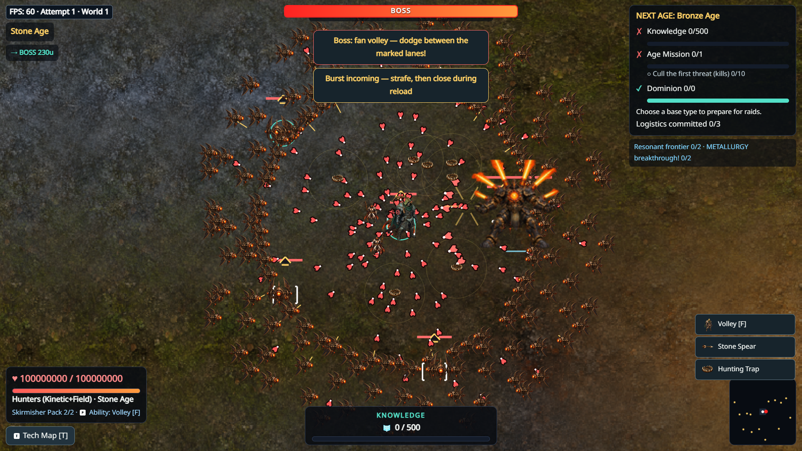
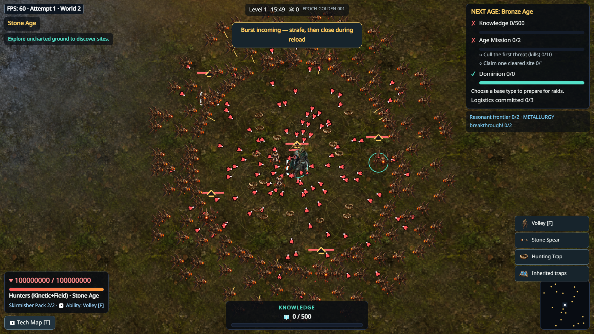

# Content15 delivery receipt — 2026-10-14

Product measured and packaged: **070098909d40cac810e2438311e54ba2c21d53ed**.
Parent: fd171b239d00827d8100ae165d551d5766630cc7. Draft [PR10](https://github.com/Ratthabhumi/-SEED/pull/10) stacks on PR9; no main merge, tag or public release.
The subsequent evidence-only commit changes documents/captures, not product source.
Its CI status must be distinguished from the verified product SHA above.

## Verified engineering and package evidence

- Exact product [push CI](https://github.com/Ratthabhumi/-SEED/actions/runs/38500135128) and [PR CI](https://github.com/Ratthabhumi/-SEED/actions/runs/38500139907): **4/4 successful each**.
- Node22/24: check/typecheck/build, **480 tests /78 files**, **53 asset provenance** checks, ZIP and release verification pass. Analyze6 and comparative progression cohort pass.
- Browser suite: **147 passed, 1 existing capture-only skip**, 27.5 minutes. Physical D3D11 native input, restart, queue, bilingual UI and Logistics regression fixtures also passed.
- Official Node22 ZIP: 6,875,025 bytes,81 entries; CRC/root/licensing/compiled-SHA verification passed. SHA256 `cacf39127f9691d180f3b2410ec1a1a3fba94c7901ad0b2f45399265e2d7a87d7`.
- Node24 ZIP SHA256 `461c947fbab53b3a7006a59559bc73812b2b7a0db95d0b3bbd13427553c25a80`.
- Download packages, exact-SHA browser captures/traces and progression evidence from the push CI run's artifacts. CI artifact retention is14 days; selected screenshots and sanitized numeric summaries are preserved here permanently.

## Corrections and retained failures

Held Space could activate a focused technology card; queued drafts could accept stale DOM callbacks. A fresh input/surface boundary prevents inherited activation and stale selections. Canonical claim feedback and full-capacity Later/Esc preserve free claims and the intentional first-Signal full-cost exemption.

Actual live stress found destroyed Phaser Text canvases retained across restart: floatTextAt/setColor/Frame.updateUVs reached null drawImage. The corrected parent-native impact/restart/impact reproduces it; pool reset passes. Autonomous Field/Defense emissions no longer recoil the handheld weapon.

The first candidate CI failed one notification assertion. Keeping queued hidden alerts intentionally changes DOM retention, but the replacement strict zero-visible assertion then found an actual350ms inherited visibility transition. Opacity/transform-only transitions fix it without weakening the visibility invariant. Initial wrong-hook/pause/CLI fixture failures are setup failures, not product evidence. Earlier failed candidate results are not final acceptance.

## Performance: open gate

[All measured summaries](evidence/content15/performance-summary.json) include the early comparison, degraded repeat, fresh warm parent/candidate comparison, failed restart diagnostics and final live normal/reduced results. Numbers are milliseconds. Physical device: Intel UHD630, ANGLE D3D11 driver31.0.101.2141.

| Final live fixture | Frame p50/p95/p99 | Simulation p95 | Renderer CPU/API p95 |
|---|---|---|---|
| Dense15 minutes |16.7 /16.8 /33.4|1.9|12.0|
| Boss20 seconds |16.7 /16.8 /16.8|2.1|10.4|
| Child World2,20 seconds |16.7 /16.8 /16.8|1.8|8.0|
| Restart20 seconds |16.7 /16.7 /16.8|2.0|9.9|
| Reduced effects30 seconds |16.7 /16.8 /33.3|3.2|12.2|

No page errors in final live normal/reduced fixtures; canonical clocks advanced throughout. Dense worst frame233.3ms, simulation45.7ms and CPU/API submission107.6ms remain visible. Heap28 observations10.5–44.4MB, last22.3MB, is not proof of leak freedom.

These are high-HP/zero-damage staged500-enemy fixtures with800 initial projectiles that retire normally, NOT a sustained500/800 workload or natural human run. Rolling240 simulation/renderer samples overlap; RAF intervals are unique. CPU/API submission is not GPU completion time.

Early paused dense frame p95: parent16.8 → candidate16.8. A later candidate repeat reached dense p95 **50.1**, ground worst **34.2**. Fresh warm parent/candidate dense results return near16.7–16.8; candidate high-contrast1920 ground worst **9.6** still exceeds8. Early candidate ground worst **11.8** also exceeds8. No thermal/other-app/driver attribution is proven. Final live first30s simulation p95 **3.6** versus parent **2.7**, while renderer CPU/API p95 **13.8** versus35.5; restart parent measurements after its crash are invalid.

Therefore **render p95<8ms and comprehensive performance acceptance remain NOT MET/UNVERIFIED**. No budget has been relaxed; universal no-regression, RELEASE_READY, GAME_COMPLETE and HUMAN_FUN_PASS are not established.

## Visual evidence and human boundary

These captures use explicit test fixture HP and enemy placement. They document integration, not natural difficulty or approved art.48 original neutral front/back costumes, floors, source images/prompts/licenses and bounds are committed. Full authored animation, six-era enemy/Guardian/environment kits, human readability/art/fun acceptance remain open.

Raw402/403 are one real clean-parent target-complete session, not two playtests. Ratings are absent. Operator feedback remains QUALITY_GATE_FAILED; earlier interrupted bug evidence remains INTERRUPTED_BY_BUG. Private raw QA/machine data stays locally preserved; sanitized evidence is published.

## Retest and research handoff

Use the single protocol in [quality report section15](CONTENT15_QUALITY_PASS.md#15-single-clean-human-retest-procedure) after checking the intended SHA/package. Given open performance/art gates, this is diagnostic review, not clean release certification. Record actual human judgments; a fresh bug interruption must remain INTERRUPTED_BY_BUG.

[Questions and facts for ChatGPT Research](CONTENT15_RESEARCH_HANDOFF.md).
