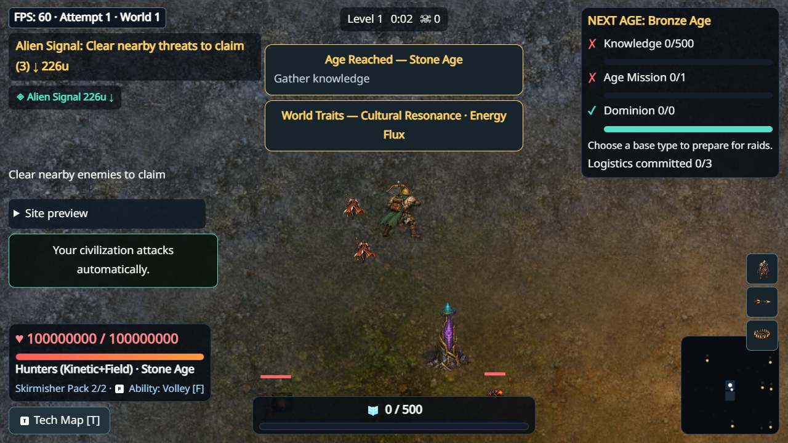
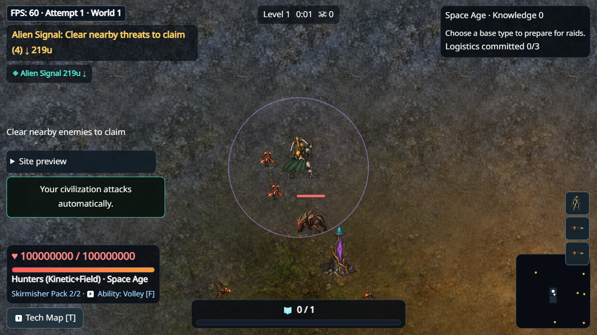

# Content15 performance and animation delivery — 2026-10-14

Starting parent PR10: efef11ef9729c3bbc388061a45b605688b6a213e, verified push
[38513285072](https://github.com/Ratthabhumi/-SEED/actions/runs/38513285072) and PR
[38513288712](https://github.com/Ratthabhumi/-SEED/actions/runs/38513288712) CI4/4.
New branch: feat/content15-perf-animation-closure-20261014, directly descended from
that parent. Final exact SHA, Draft PR and CI/package receipt are published in the
PR body after commit. No main merge/tag/public release or Content16/v0.27.

## Delivered engineering

Optional bounded phase profiler, correlated User Timing traces and asynchronous
WebGL1/2 GPU queries; no blocking GPU synchronization. Numeric13-glyph/12-slot
BitmapText remains opt-in because Text did not dominate the measured p95.
Cached unchanged hostile arrowhead/outline/tip geometry in one64-glyph1MiB atlas
and1000-quad mesh, with vector/Canvas/overflow fallback and diagnostic comparator.
Terrain scheduling unchanged; separate canvas/upload/Worker/cache diagnostics added.

Same-build vector/cache short traces: Graphics CPU p95 **3.1→.9ms**, renderer
boundary **8.0→5.8ms**; GPU query p95 **9.201→8.282ms**, zero disjoint samples.
This supports CPU polygon interpretation/tessellation savings, not a universal
GPU/thermal cause. The earlier larger diagnostic22.6→10.1ms is exploratory and
highly instrumented; do not substitute it for independent acceptance.

## Final independent advancing live fixture

Intel UHD630 / ANGLE D3D11 driver31.0.101.2141,1920×1080, profiler disabled.

| Scenario | Frame p50/p95/p99 | Sim p95 | Renderer CPU/API p95 |
|---|---|---|---|
| Dense15 minutes |16.7 /16.7 /16.8|1.5|4.7|
| Boss20 seconds |16.7 /16.7 /16.8|1.6|4.9|
| World2,20 seconds |16.7 /16.8 /16.8|1.7|4.9|
| Restart20 seconds |16.7 /16.7 /16.8|1.1|4.3|

Zero page errors, advancing clocks throughout. Dense worst frame66.7ms, sim20.4ms,
CPU/API62.5ms remain visible.500 high-HP enemies,800 initial projectiles retire
normally; NOT sustained500/800 or a natural human run. Frames are unique RAF
intervals; live sim/render samples are overlapping240-frame windows observed each
second, explicitly separated from the unique-frame diagnostic/paired samples.
Short trace parsing occurred near startup on the shared host; first30s prefix is
not an isolated experiment. No forced GC/thermal/power-mode certification.

## Paired repeatability: all240 rows retained

Five alternating ABBA/BAAB blocks,20 fresh browser processes, six viewport/graphics
conditions, separate cold startup/warm settled samples,10 observations per label/
condition. Paused500 enemies/800 friendly projectiles, same seed/input policy.
These friendly-only paused scenes do not exercise the hostile glyph optimization;
they check broader rendering cost, animation integration and streaming variance.
Cold means browser/context/texture state, not disk-cache eviction. Startup hashes
are recorded, not asserted equal across different wall-clock bootstrap timings.

| Viewport/mode/cache | Parent median render p95 | Candidate median render p95 | Candidate range |
|---|---|---|---|
|720 normal cold/warm|1.90 /1.00|2.10 /1.25|1.6–3.7 /1.1–2.4|
|720 reduced cold/warm|1.70 /1.00|1.90 /1.25|1.5–3.3 /1.0–2.3|
|720 contrast cold/warm|6.70 /5.45|6.90 /5.60|5.9–15.3 /5.2–9.4|
|1080 normal cold/warm|3.10 /1.70|3.35 /1.80|2.5–8.6 /1.5–6.7|
|1080 reduced cold/warm|3.05 /1.75|3.15 /2.25|2.5–6.5 /1.5–4.6|
|1080 contrast cold/warm|9.85 /8.05|9.30 /7.30|7.4–22.2 /6.8–20.4|

Normal/reduced candidate median costs slightly increase; this is not a universal
no-regression result. Some candidate render p95 values exceed8ms. Observed terrain
upload lifetime/startup worst reaches31.6ms candidate versus42.7ms parent; these
counters retain earlier startup maxima and cannot be attributed to warm rows.
Both exceed8ms; refresh/upload cost definitions must remain distinct. Unchanged
scheduler does not solve the spikes. Paired variability remains unresolved, and
five blocks do not isolate driver/OS/thermal/background-app causes.

**PERFORMANCE_GATE_OPEN; RENDER_P95_TARGET_FAILED across required conditions;
REPEATABILITY_UNRESOLVED.** The measured advancing-live render target is met in
that scoped fixture, but comprehensive performance acceptance is not established.
No thresholds, effects, damage, populations or canonical caps were reduced.

## Reference art and production pipeline

36 original distinct Hunters Stone/Space front/back key poses, source/generation
summary/license, reproducible PNG/Phaser atlas/metadata export, native clip
registration and canonical-time playback, feet/collision/socket metadata and
real-event revision restarts. Two-frame walk/attack; single idle/hurt/dash/ability/
death poses. Full authored in-betweens and other Origins/Ages/Guardian/enemy/world
kits remain pending. Source and PNG-sequence roundtrip reproduce exact atlas bytes;
duplicate poses/empty frames/bounds/provenance are checked automatically.

[Short native staged reference video](evidence/content15-closure/reference-stone-staged.webm).
These are explicit fixtures, not human playtests or approved art.

See [production contract](ANIMATION_PRODUCTION_CONTRACT.md) for native-scale art
direction, lifecycle, tooling and memory budgets. ANIMATION_PIPELINE_VERIFIED is
limited to the documented36-pose reference import/export/timing contract;
REFERENCE_ANIMATION_INTEGRATED is sparse motion. FULL_ANIMATION_LIBRARY_PENDING,
HUMAN_ART_ACCEPTANCE_PENDING and HUMAN_FUN_VERDICT_PENDING remain.

## Verification, evidence and next review

First b6d43bf PR CI38525799632 passed150 browser cases, skipped1 existing case
and failed the new cache fixture: glyph count0 after2.2 wall seconds on software
rendering. Wall duration does not ensure an actual canonical shot. Corrective
test polls for the real rendered glyph (30s cap), retaining positive count and
≤64 pool assertions; no renderer/core/threshold change. Keep first failed run
as evidence and use corrected exact-head CI for final acceptance.

Local complete check483 tests/79 files,54 provenance/typecheck/build; Analyze6;
physical native28 integration cases plus final4 video/real-input gait/restart cases.
Final exact-head CI and official ZIP verification are recorded in the Draft PR
receipt. Retained failures: manifest author/resize metadata and unmanifested JSON
exports (3 assertions); corrected metadata and moved exports to source assets
without changing tests. Node type declarations corrected using existing test
conventions, no dependency. Old failed/degraded Content15 results remain historical.

[All240 paired rows, every live scenario and diagnostic summaries](evidence/content15-closure/performance-summary.json).
[Research execution and remaining questions for ChatGPT](research/CONTENT15_RENDERER_AND_ANIMATION_20261014.md).
Large raw traces/private QA remain locally preserved; sanitized summaries, selected
captures/video, source artwork, runtime assets and metadata are committed.

Core/content/package dependencies and Worldgen3 / Content15 / Save2 unchanged.
New incoming human session384 is tied to clean efef11e, target-complete, Engineers,
Space/boss/World2 route, no submitted fun ratings; its sanitized evidence is kept.
Do not relabel older interrupted sessions or infer HUMAN_FUN_PASS.

After reviewing exact CI/SHA, one local command: `npm run qa:human`. Given the open
performance/art gates, a fresh session is diagnostic review, not release approval.
Use the existing consolidated human protocol; record actual art/readability/fun
feedback and preserve a bug interruption as INTERRUPTED_BY_BUG.
