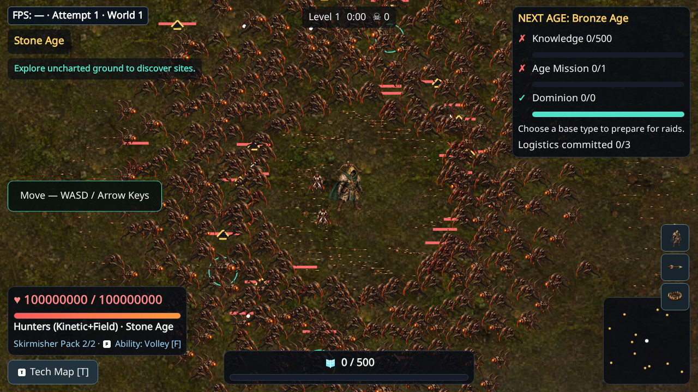

# First exact-head CI failure — retained evidence

Build b6d43bf5f9c6f47b1dd06bb80ddf1144c38059b7.
[PR run38525799632](https://github.com/Ratthabhumi/-SEED/actions/runs/38525799632)
and [push38525691478](https://github.com/Ratthabhumi/-SEED/actions/runs/38525691478)
failed the new hostile-cache test; PR result150 passed/1 existing skip/1 failed.

Trace readback after the fixed wall wait: glyphs0, maxGlyphs64, atlasBytes1,048,576.
Thus the WebGL cache exists; this is not the Canvas fallback. The screenshot
still shows0:00 elapsed and the initial friendly-shot fixture. The test assumed
2.2 wall seconds guarantee an actual enemy shot on software rendering.

Corrective test waits for an actual rendered glyph (30s maximum), still requires
glyphs>0 and≤64 and runs the same numeric/restart assertions. Default software
Chromium local corrective run passes (1.6 minutes including startup). No product,
canonical simulation, performance threshold or coverage changed. Full corrected
exact-head CI remains required. Complete failed trace/video/artifacts are retained
in local scratch; GitHub failure artifacts remain linked to their historical run.

