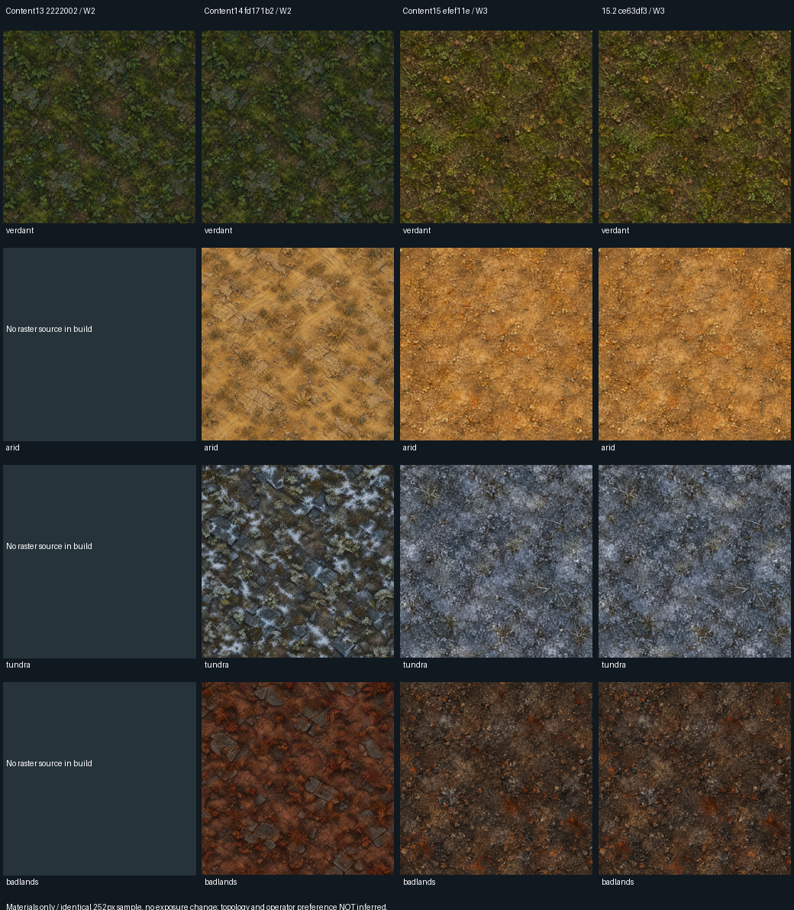

# Content15.3 retained engineering evidence

Source head `081ec5b802de5a715fd050a0587df458850a2911`; PR merge compiled as `c74079f78bf7bcd518359cedbf7b3b0b6aaedb7c`. These results came from [PR run 38657196755](https://github.com/Ratthabhumi/-SEED/actions/runs/38657196755), whose E2E job FAILED. They are retained evidence, not certification of the corrected head. Parent `ce63df35d52e8b3041d232f5e8e3438c087cecf8`.

## Full canonical progression policies

36 pairs: four Origins × three seeds × balanced/damage/survival; 1200s cap, no stat grants or forced phases.

|Outcome|Parent|Content16 candidate|
|--|--:|--:|
|runs|36|36|
|reached|24|24|
|killed|22|22|
|phase2|21|22|
|phase2Attacks|19|21|
|unreached|12|12|

Phase2 attacks improve from19/36 to21/36; this is21/24 reached bosses, not21/36 successes in human play. Twelve unreached cases and deaths remain. Full encounter traces and measured builds are in prior-natural-boss.json. No hidden immortality or HP multiplication is used; extreme lethal hits remain lethal. Natural boss-quality acceptance stays OPEN.

## Paired paused renderer (CI software device)

Median of ten per-run render p95 values per condition, ms. Friendly fixture holds500 enemies/800 projectiles. Each experiment retains240 rows, five ABBA/BAAB blocks. Cold is a fresh context, not OS cache eviction. Upload maxima include startup.

|Width|Mode|Cold parent → candidate|Warm parent → candidate|Candidate ≥8ms runs cold / warm|
|--|--|--:|--:|--:|
|1280|normal|5.60 → 7.10|1.65 → 2.30|4 / 0|
|1280|reduced|7.65 → 8.60|2.15 → 1.95|5 / 0|
|1280|contrast|5.95 → 4.65|3.40 → 3.60|2 / 0|
|1920|normal|7.75 → 6.10|3.50 → 2.20|3 / 0|
|1920|reduced|6.70 → 8.35|3.40 → 3.45|6 / 0|
|1920|contrast|24.95 → 24.35|3.65 → 4.05|10 / 0|

Strict render<8ms remains OPEN. Measurement execution success is not performance acceptance. The same-build hostile-art comparator and all maxima are in prior-performance-summary.json. CI software results do not certify Intel hardware. No threshold or canonical counts were reduced.

## Controlled material comparison / alpha bounds

historical-materials.json records all exact SHAs/Worldgen versions and missing historical raster sources. Samples normalize252px area, filtering/exposure; this compares source materials, not identical generated worlds or native tile-edge transitions. Operator preference remains pending. readability.json contains144 neutral-body alpha/camera projections; native Hunters motion and clutter readability remain separate gates.

## Original durable artifact references

[Starting E2E failures and exact correction rationale](starting-ci-failures.md).

- Render data: [artifact11939310417](https://github.com/Ratthabhumi/-SEED/actions/runs/38657196755/artifacts/11939310417), archive digest76efdfba8dd46686d3561d931df9c5d884a7c7b966f94b8076efb455265032d1.
- Full progression: [artifact11936424499](https://github.com/Ratthabhumi/-SEED/actions/runs/38657196755/artifacts/11936424499), archive digest104c9e499e7b57253377376a6ccb9e118bddbe69a8f210ca5e3ed1307821145f.
- CI artifacts expire2026-10-29; the selected summaries/traces above are committed for durable review. Public CI data only; no raw human reports, local usernames, or signed download URLs are published.
