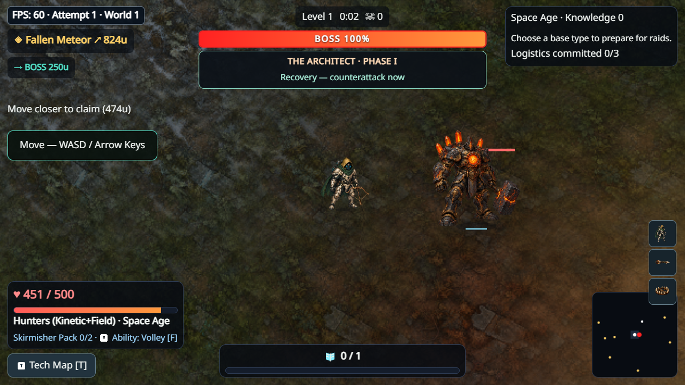

# V3.2 native visual gate

Before: actual official PR21/835a25f package. After: explicitly **dirty
development preview**, recovered source detail + grounded facing/recovery.
Both1280x720, same staged Boss pattern/clock/viewport; full startup histories
are not claimed equal. This is a visual engineering gate, not human approval.

Before:

After:

[Receipt](early-receipt.json) records actual served stamps, SHA256 and lengths.
Moving footage includes live keyboard strafing/real autoattacks in the six-age
Hunters fixtures, real canonical Boss warning/impact/recovery and Atomic beam.
Final clean screenshots/short clips, complete observations and source stamps
are regenerated by `scripts/capture-v32-slice.mjs` into the PR's CI visual
artifact (`v32-final/`), with a small separate `v32-slice-*` artifact containing
the paired clips, Boss/beam PNGs and reports for quick owner review.
Do not relabel early dirty footage as final clean.

[Scale audit](alpha-scale.json):196 unchanged/source-derived cells across11
roles, alpha>64 unoccluded projected bounds, not actual occluded framebuffer
counts or human readability. Hero reference is roughly70–102px wide at720,
ordinary enemies31–68px, squad32–47px, Boss158–182px (roughly1.2x at1080).
The hero/ordinary/Boss hierarchy is retained; recover detail/grounding instead
of uniformly enlarging every actor. UI scaling does not enlarge world actors.
Skill warnings still use their actual canonical geometry; no fake larger hitbox.

[Stack snapshot](integration-stack.json) supports INTEGRATION_READINESS.
All final engineering/performance/natural/World2 receipts are on the one new
Draft PR. Previous PR21 measurements stay under their original SHA. Original31
human complaints, full painted anatomy dependency and fun ratings remain open.
