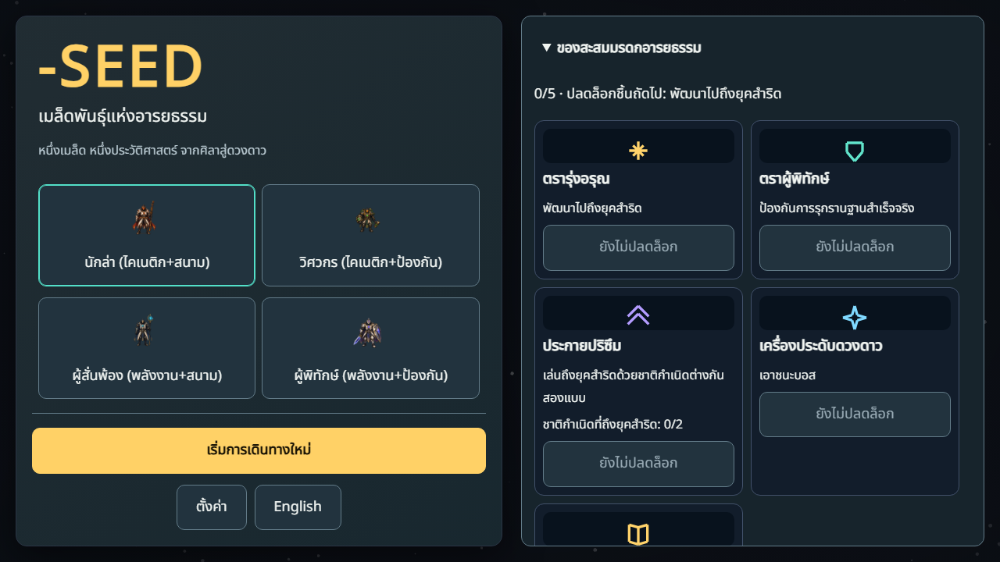
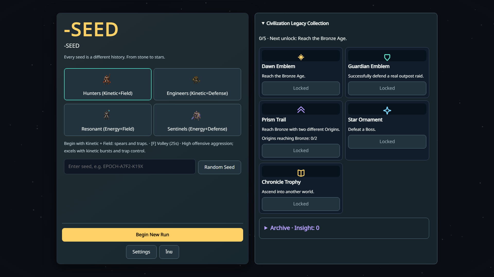
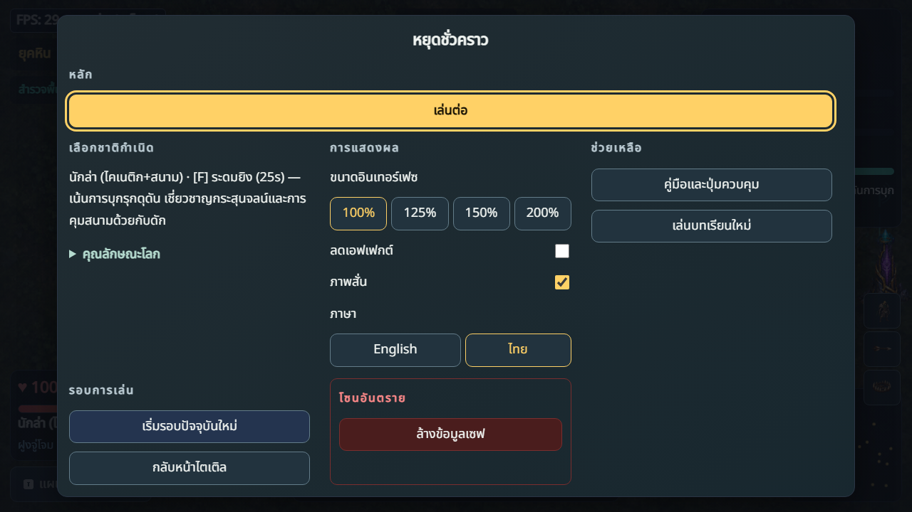
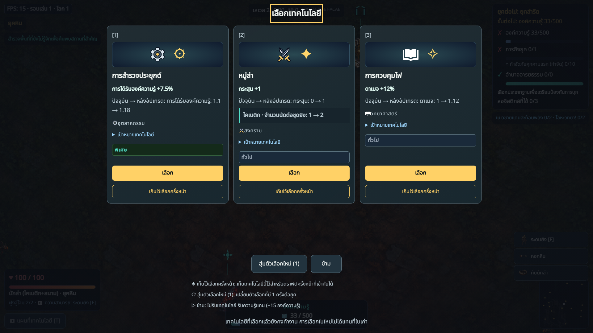
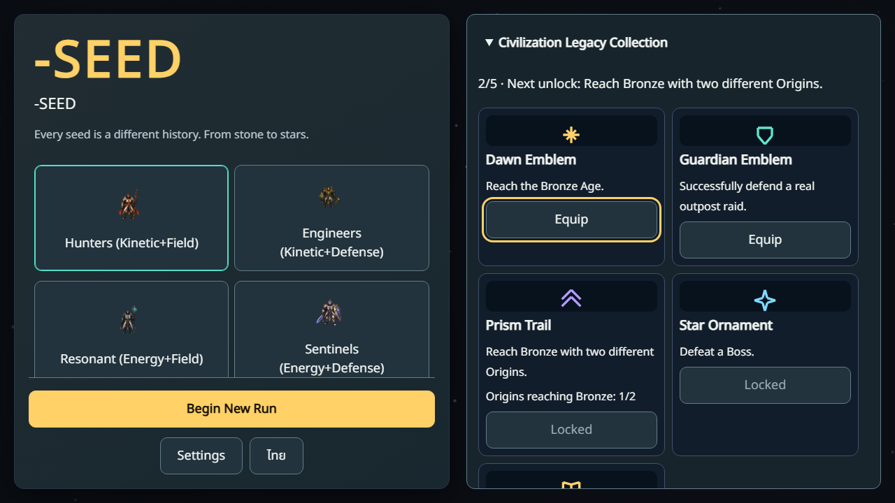
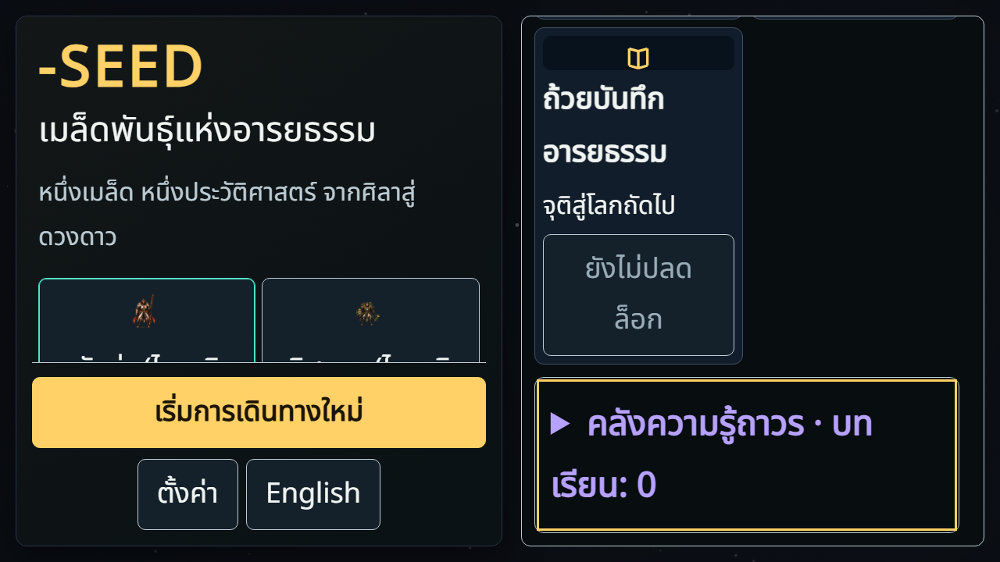
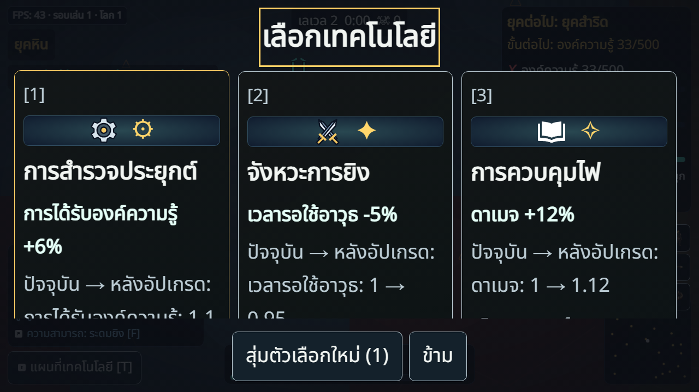
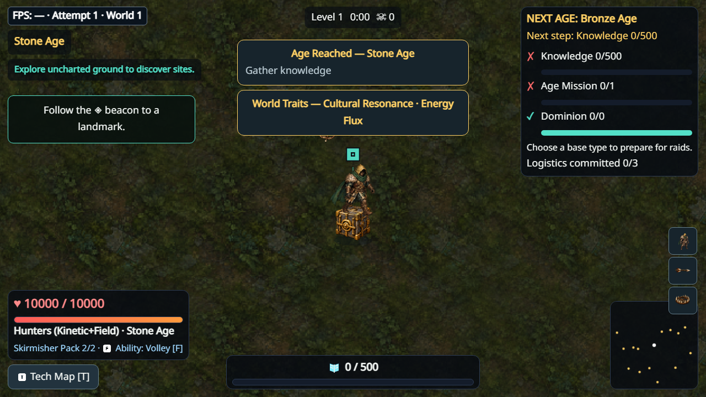

# V4.7 candidate browser gallery

Staged local Playwright captures from the final candidate runtime, before the
source commit stamps its SHA. Exact committed-source captures are independently
uploaded by Push/PR CI. These are not human acceptance or native performance tests.
One cold Draft capture overlays FPS15; do not hide it or infer physical60Hz PASS.
At720p the long collection uses its deliberate sidebar scroll; Start stays visible.

poi-pixel.json records2948 image-difference pixels and a1.5ms CPU post-render
checkpoint after discovery in this run. The former is raster evidence; the
latter is explicitly NOT GPU completion/presentation or a latency guarantee.
The destination is already identified before the canonical discovery reward.

parent-source-proof.json verifies61 archived parent source blobs against57df3d1
after CRLF-to-LF normalization for text only. The comparison script's unchecked
cache-reuse behavior is a deferred minor, not a claim about arbitrary future caches.
